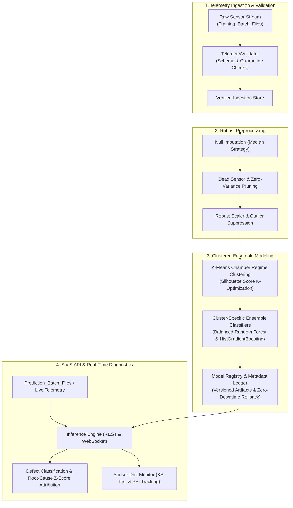

# 🔬 WaferGuard: Industrial MLOps SaaS & Sensor Anomaly Platform

> **End-to-End MLOps SaaS for Semiconductor Predictive Maintenance, Chamber Operational Regime Clustering, and Real-Time Defect Root-Cause Attribution.**

<p align="center">
  
  
  
  
  
  
</p>

---

## 🏭 Industrial Overview

In semiconductor fabrication plants (fabs), wafer defects undetected before packaging result in millions of dollars in yield loss and equipment downtime. Multi-sensor telemetry streaming from chemical mechanical planarization (CMP), photolithography, and plasma etching tools must be continuously inspected for sub-micron process shifts.

**WaferGuard** is a complete, production-grade MLOps SaaS that ingests raw multi-sensor telemetry, validates strict data contracts, clusters chamber operational regimes using K-Means, trains specialized ensemble classifiers per chamber, monitors sensor distribution drift (KS-test & PSI), and attributes wafer defects directly to root-cause anomalous sensors.

---

## ⚡ Architecture Topology & Data Flow



---

## 💻 Tech Stack

- **Machine Learning & Core Pipelines**: Python 3.9+, Scikit-Learn (K-Means, Balanced Random Forest, HistGradientBoosting, RobustScaler), Scipy (two-sample Kolmogorov-Smirnov test), Pandas, NumPy, Joblib.
- **Backend API & Streaming Engine**: FastAPI, Uvicorn, Pydantic V2, SQLAlchemy, WebSockets, aiosqlite.
- **Frontend SPA**: React 18, Vite, Tailwind CSS, Lucide Icons, Canvas / SVG Silicon Wafer Die Map.
- **Packaging & Orchestration**: Docker, Docker Compose, Makefile.

---

## 🛠️ API Surface & Capabilities

| Endpoint | Method | Functionality |
| :--- | :--- | :--- |
| `/health` | `GET` | System operational health and version status |
| `/api/v1/datasets` | `GET` | List all ingested batches with validation summaries |
| `/api/v1/datasets/upload` | `POST` | Upload and validate new sensor telemetry CSV batch |
| `/api/v1/datasets/generate-sample` | `POST` | Generate realistic synthetic wafer telemetry lots |
| `/api/v1/datasets/{filename}/preview` | `GET` | View raw rows preview and sensor channel statistics |
| `/api/v1/train` | `POST` | Trigger asynchronous background retraining pipeline |
| `/api/v1/train/jobs` | `GET` | List all training jobs with stage progress and metrics |
| `/api/v1/train/jobs/{id}` | `GET` | Real-time status and stage progress for a specific job |
| `/api/v1/models` | `GET` | List registered model versions and evaluation cards |
| `/api/v1/models/active` | `GET` | Retrieve currently active production model card |
| `/api/v1/models/promote` | `POST` | Promote candidate model version to active production |
| `/api/v1/models/rollback` | `POST` | Roll back to previous active model version |
| `/api/v1/predict/single` | `POST` | Real-time single wafer prediction with root-cause attribution |
| `/api/v1/predict/batch` | `POST` | Batch inference on CSV files with yield rate calculations |
| `/api/v1/monitoring/drift` | `GET` | Calculate Kolmogorov-Smirnov and PSI sensor drift stats |
| `/api/v1/monitoring/fab-overview` | `GET` | Chamber health matrix, live recipes, and sensor readouts |
| `/ws/telemetry` | `WebSocket` | Real-time sensor pulse streaming from fabrication chambers |

---

## 🚀 Quickstart & Reproduction

### 1. Environment Setup
```bash
git clone https://github.com/krishujeniya/WaferGuard.git
cd WaferGuard

# Create Python virtual environment
python3 -m venv .venv
source .venv/bin/activate

# Install dependencies
pip install -r requirements.txt
```

### 2. Run the MLOps Pipeline
```bash
# Execute end-to-end training pipeline
make train

# Run batch inference
make predict
```

### 3. Run the Full Test Suite
```bash
make test
```

### 4. Start the Application
```bash
# Terminal 1: Launch FastAPI Backend (Port 8000)
make run-backend

# Terminal 2: Launch Vite React Dashboard (Port 3000)
make run-frontend
```

Open your browser at `http://localhost:3000` to access the Fab Dashboard, Pipeline Lab, Model Registry, Inference Studio, and Drift Monitor.

---

## 🐳 Docker Deployment

To launch the full-stack MLOps platform in containers:

```bash
docker-compose up --build
```
- Backend API docs: `http://localhost:8000/docs`
- Interactive Dashboard: `http://localhost:3000`

---

## 📄 License
This project is licensed under the MIT License - see the [LICENSE](LICENSE) file for details.
