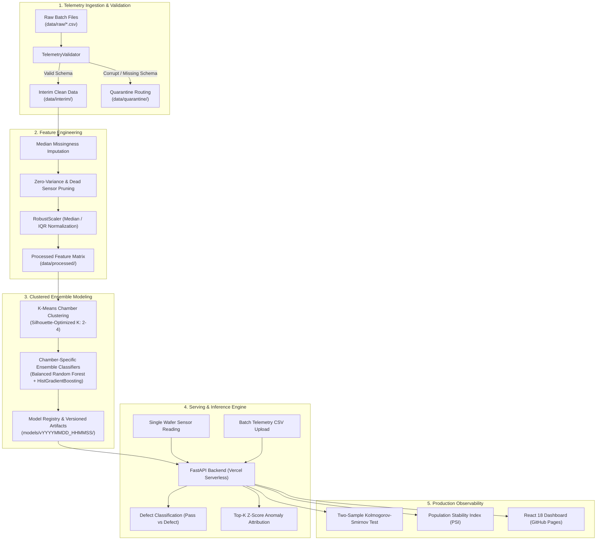

# WaferPulse: Industrial MLOps Platform for Semiconductor Wafer Fault Detection

<p align="center">
  
</p>

<p align="center">
  <a href="https://github.com/krishujeniya/WaferPulse/actions/workflows/ci.yml"></a>
  <a href="https://github.com/krishujeniya/WaferPulse/actions/workflows/deploy-pages.yml"></a>
  <a href="https://www.python.org/"></a>
  <a href="https://fastapi.tiangolo.com/"></a>
  <a href="https://react.dev/"></a>
  <a href="https://tailwindcss.com/"></a>
  <a href="https://opensource.org/licenses/MIT"></a>
</p>

WaferPulse is an end-to-end MLOps platform engineered for semiconductor manufacturing fabrication plants (fabs). It ingests multi-channel sensor telemetry, validates data contracts against schema definitions, clusters operational chamber regimes using K-Means, trains specialized ensemble classifiers per chamber, detects distribution drift using Kolmogorov-Smirnov tests and Population Stability Index (PSI), and diagnoses wafer defects using Z-score anomaly attribution.

---

## Live Deployments

- **Production Frontend Dashboard**: [https://krishujeniya.github.io/WaferPulse/](https://krishujeniya.github.io/WaferPulse/)
- **Production Backend API**: [https://waferpulse.vercel.app](https://waferpulse.vercel.app)
- **Interactive Swagger Documentation**: [https://waferpulse.vercel.app/docs](https://waferpulse.vercel.app/docs)
- **API Health Endpoint**: [https://waferpulse.vercel.app/health](https://waferpulse.vercel.app/health)

---

## Brand Psychology & Name Derivation

The name **WaferPulse** was constructed through cognitive psychology and psycholinguistic frameworks:

| Principle | Theoretical Foundation | Application to WaferPulse |
| :--- | :--- | :--- |
| **Cognitive Processing Fluency** | Alter & Oppenheimer (2009) | Three-syllable trochaic cadence (`Wa-fer-Pulse`). High phonotactic probability enables rapid lexical retrieval and working memory retention with low cognitive load. |
| **Phonosemantic Contrast (Bouba / Kiki)** | Ramachandran & Hubbard (2001) | Fuses rounded, fluid phonemes (`W`, `f`, `r`) representing the circular silicon substrate with sharp, plosive stops (`P`, `l`, `s`) signaling micro-temporal measurement and high-frequency instrumentation. |
| **Dual-Coding Theory** | Paivio (1986) | Triggers simultaneous associative retrieval: the physical object schema (the 300mm silicon wafer) and the operational telemetry dynamic (the continuous streaming pulse of fab chambers). |
| **Schema Congruence & Category Archetyping** | Aaker (1997); Bagozzi et al. (2021) | Eliminates generic defensive stereotypes (such as "Guard", which signals low-complexity consumer software) in favor of active industrial diagnostics aligned with leading semiconductor toolmakers (ASML, Applied Materials, KLA, Lam Research). |
| **Mayer Credibility Matrix** | Mayer, Davis & Schoorman (1995) | Signals deep engineering competence, process transparency, and instrumentation integrity required by fab process control engineers. |

---

## System Architecture



---

## Directory Structure

The project follows the Cookiecutter Data Science and Cookiecutter MLOps architectural layout:

```
WaferPulse/
├── .github/
│   └── workflows/
│       ├── ci.yml                 # Ruff linting, test suite ratchet, and frontend build
│       └── deploy-pages.yml       # Automated GitHub Pages deployment pipeline
├── api/
│   └── index.py                   # Vercel serverless entry point
├── assets/
│   ├── waferpulse-logo.svg        # Official brand logo vector
│   └── social-card.svg            # OpenGraph visual card
├── backend/
│   └── app/
│       ├── config.py              # Environment configuration and serverless storage path routing
│       ├── main.py                # FastAPI app initialization and route registration
│       ├── db/
│       │   ├── database.py        # SQLAlchemy engine and session factory
│       │   └── models.py          # Relational schemas for datasets, jobs, and alerts
│       ├── routers/
│       │   ├── datasets.py        # Dataset upload, synthetic generation, and previews
│       │   ├── models.py          # Model registry version listing, promote, and rollback
│       │   ├── monitoring.py      # PSI/KS sensor drift and chamber health metrics
│       │   ├── predict.py         # Single wafer diagnosis and batch prediction
│       │   └── train.py           # Background pipeline execution and job tracking
│       ├── schemas/               # Pydantic V2 input/output validation models
│       └── services/              # Pipeline execution and telemetry streaming logic
├── data/
│   ├── external/                  # Third-party baseline references
│   ├── interim/                   # Validated, clean telemetry batches
│   ├── prediction/                # Production batch prediction inputs
│   ├── processed/                 # Imputed, scaled feature matrices
│   ├── quarantine/                # Schema-rejected batches
│   └── raw/                       # Raw sensor telemetry CSVs
├── frontend/                      # React 18 single-page application
│   ├── public/
│   │   ├── favicon.svg            # Silicon disc & pulse favicon
│   │   └── logo.svg               # Vector brand badge
│   ├── src/
│   │   ├── components/            # WaferMap, PipelineVisualizer, MetricCard, Navbar
│   │   ├── pages/                 # Dashboard, Inference, PipelineLab, ModelRegistry, Monitoring
│   │   └── services/              # Axios API client configured for production endpoints
│   ├── vite.config.js             # Vite configuration with GitHub Pages base path (/WaferPulse/)
│   └── package.json
├── models/
│   ├── active_model.json          # Active model pointer and promotion audit trail
│   ├── preprocessor.joblib        # Fitted scaler and feature metadata
│   └── v20261108_233353/          # Versioned ensemble, clusterer, and metadata
├── notebooks/
│   └── 1.0-wafer-sensor-exploratory-analysis.ipynb
├── references/
│   └── data_dictionary.md         # Sensor channel engineering definitions
├── reports/
│   └── figures/                   # Silicon die heatmaps and drift visualizations
├── src/
│   ├── data/
│   │   ├── generator.py           # Multi-chamber wafer telemetry generation
│   │   ├── make_dataset.py        # Dataset build CLI
│   │   └── validator.py           # Data contract and schema validator
│   ├── explain/
│   │   └── root_cause.py          # Top-K Z-score anomaly attribution engine
│   ├── features/
│   │   ├── build_features.py      # Feature engineering CLI
│   │   └── preprocessor.py        # Imputation, dead-sensor drop, RobustScaler
│   ├── models/
│   │   ├── clusterer.py           # Silhouette-optimized K-Means clustering
│   │   ├── ensemble.py            # Chamber-specific balanced ensemble
│   │   ├── predict_model.py       # Batch inference CLI
│   │   ├── registry.py            # Local model registry with promotion/rollback
│   │   └── train_model.py         # Model training CLI
│   ├── monitoring/
│   │   └── drift.py               # Population Stability Index and KS-test engine
│   └── visualization/
│       └── visualize.py           # Wafer die maps and drift SVG generators
├── tests/
│   ├── test_api.py                # FastAPI REST endpoint integration tests
│   ├── test_cookiecutter_pipeline.py # Dataset and visualization CLI tests
│   └── test_ml_pipeline.py        # Unit tests for MLOps pipeline components
├── Dockerfile.backend             # Container definition for backend
├── Dockerfile.frontend            # Container definition for frontend
├── docker-compose.yml             # Local multi-service orchestration
├── Makefile                       # Standard execution targets
├── requirements.txt               # Locked production dependencies
├── setup.py                       # Installable package definition
└── vercel.json                    # Vercel serverless deployment configuration
```

---

## Technical Details

### 1. Multi-Chamber Operational Regime Clustering
Semiconductor processing tools exhibit distinct physical operating regimes across chemical mechanical planarization (CMP), lithography, and plasma etching. Rather than training a single monolithic model across disparate baselines, WaferPulse runs K-Means clustering with automated silhouette score optimization ($K \in [2, 4]$) to segment wafers into distinct operational clusters before defect classification.

### 2. Clustered Ensemble Classifiers
Wafer failure in high-volume fabs is a rare event (typically 5% to 8% defect rate). WaferPulse pairs each chamber cluster with an isolated ensemble composed of:
- **Balanced Random Forest**: Re-balances bootstrapping to handle extreme class imbalance without synthetic data corruption.
- **HistGradientBoosting**: Captures non-linear sensor correlations and interaction effects.

Predictions are combined using soft probability voting, producing calibrated defect probabilities alongside binary pass/defect classifications.

### 3. Root-Cause Anomaly Attribution
When a wafer is flagged as defective, the platform calculates directional Z-score deviations against baseline chamber statistics:

$$Z_i = \frac{x_i - \mu_{\text{baseline}, i}}{\sigma_{\text{baseline}, i}}$$

The top-$K$ deviating channels are surfaced in real time with direction (`HIGH` / `LOW`), absolute Z-score, and severity ratings (`CRITICAL`, `WARNING`, `NOMINAL`), pointing process engineers directly to failing equipment components.

### 4. Sensor Drift Monitoring
Sensor distribution shifts indicate chamber contamination, RF generator degradation, or optical wear. WaferPulse computes:
- **Two-Sample Kolmogorov-Smirnov Test**: Identifies continuous distribution divergence ($p < 0.05$).
- **Population Stability Index (PSI)**: Quantifies shift severity across 10 quantile bins:
  - $\text{PSI} < 0.10$: Stable
  - $0.10 \le \text{PSI} < 0.25$: Moderate Drift / Process Shift
  - $\text{PSI} \ge 0.25$: Critical Drift / Tool Recalibration Required

---

## API Surface

| Method | Endpoint | Description |
| :--- | :--- | :--- |
| `GET` | `/health` | Service health and version status |
| `GET` | `/api/v1/datasets` | Ingested telemetry batches and schema validation status |
| `POST` | `/api/v1/datasets/upload` | Upload and validate raw CSV batch file |
| `POST` | `/api/v1/datasets/generate-sample` | Generate synthetic multi-chamber wafer batches |
| `GET` | `/api/v1/datasets/{filename}/preview` | Preview rows and sensor statistics for a batch |
| `POST` | `/api/v1/train` | Trigger asynchronous background training run |
| `GET` | `/api/v1/train/jobs` | List training runs with stage progress and metrics |
| `GET` | `/api/v1/train/jobs/{id}` | Detailed status and evaluation card for a training job |
| `GET` | `/api/v1/models` | List all versioned models in registry |
| `GET` | `/api/v1/models/active` | Active production model metadata |
| `POST` | `/api/v1/models/promote` | Promote model version to production |
| `POST` | `/api/v1/models/rollback` | Roll back to previous active model version |
| `POST` | `/api/v1/predict/single` | Single wafer prediction with root-cause diagnosis |
| `POST` | `/api/v1/predict/batch` | Batch inference on uploaded or existing CSV files |
| `GET` | `/api/v1/monitoring/drift` | Multi-sensor PSI and Kolmogorov-Smirnov drift statistics |
| `GET` | `/api/v1/monitoring/fab-overview` | Real-time chamber health, active recipes, and yield rates |
| `WS` | `/ws/telemetry` | WebSocket stream for simulated real-time chamber telemetry |

---

## Quickstart

### Prerequisites
- Python 3.10+ (Python 3.12 recommended)
- Node.js 18+ or Bun
- Git

### 1. Repository Setup
```bash
git clone https://github.com/krishujeniya/WaferPulse.git
cd WaferPulse

python3 -m venv .venv
source .venv/bin/activate
pip install -r requirements.txt
```

### 2. Standard Workflow Commands
```bash
# Ingest and validate raw telemetry files into interim data
make data

# Build feature matrices and fit preprocessor
make features

# Execute model training and version packaging
make train

# Run batch inference on prediction files
make predict

# Generate wafer die map and sensor drift figures
make visualize

# Run full test suite
make test

# Verify code quality
make lint
```

### 3. Local Development Servers
```bash
# Terminal 1: Launch FastAPI Backend (Port 8000)
make run-backend

# Terminal 2: Launch Vite React Frontend (Port 3000)
make run-frontend
```

Access the frontend application at `http://localhost:3000` and Swagger documentation at `http://localhost:8000/docs`.

---

## Containerized Deployment

Run the complete platform locally using Docker Compose:

```bash
docker-compose up --build
```

- Frontend: `http://localhost:3000`
- Backend API: `http://localhost:8000`
- API Documentation: `http://localhost:8000/docs`

---

## Testing & Quality Ratchet

Continuous integration enforces zero regressions on every commit:
- **Linting**: Checked with Ruff (`ruff check --select E,F --ignore E501 src backend`).
- **Tests**: 15 unit and integration tests passing in pytest across data generation, schema validation, feature engineering, clustering, ensemble training, root-cause attribution, and REST endpoints.
- **CI Workflows**: Automated on GitHub Actions (`.github/workflows/ci.yml` and `.github/workflows/deploy-pages.yml`).

```bash
PYTHONPATH=. pytest tests/ -v
```

---

## License

This project is licensed under the MIT License - see the [LICENSE](LICENSE) file for details.
